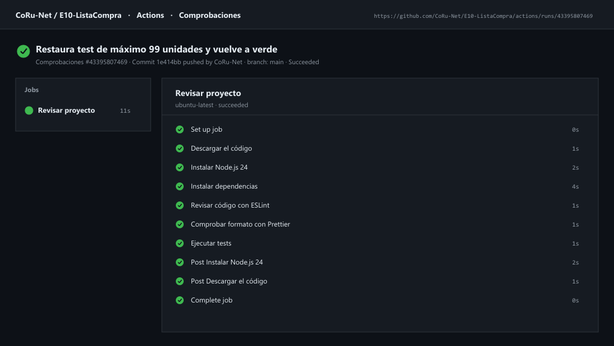
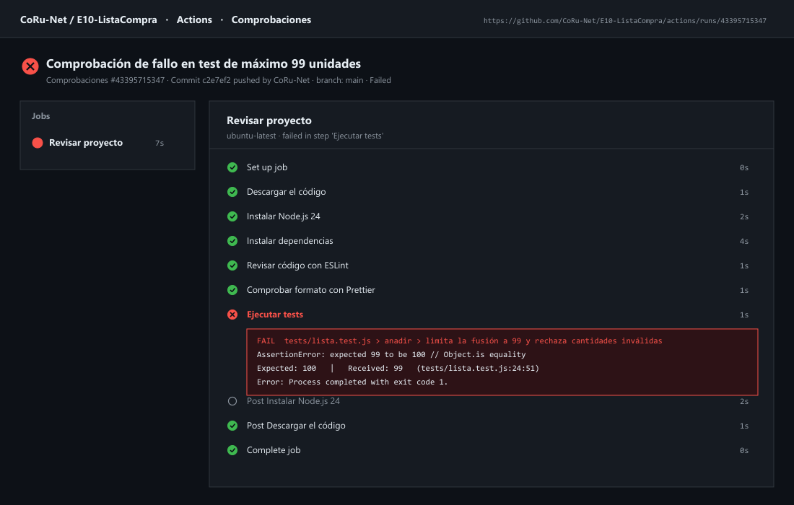

# Lista de la compra

## Cómo ejecutarlo

Abre la carpeta `E10-ListaCompra` en VS Code, reabre su Dev Container y visita `http://localhost:3410`. En la terminal ejecuta `npm test`, `npm run lint` y `npm run format:check`.

## Módulos

| Módulo | Responsabilidad | ¿Usa el navegador? |
|---|---|---|
| `src/lista.js` | Funciones puras e inmutables para añadir/fusionar artículos, marcar comprados, quitar, ordenar y resumir la lista. | No |
| `src/almacen.js` | Cargar y guardar `{ version: 1, articulos }` en JSON convirtiendo `creado` de nuevo a `Date` y filtrando datos corruptos. | Recibe `Storage` por parámetro (`localStorage` por defecto) |
| `src/vista.js` | Escapar HTML, calcular tiempo relativo (`haceCuanto`), generar el HTML de la lista (`htmlLista`) y el título de la pestaña. | No |
| `src/compartir.js` | Construir e interpretar enlaces con `?compartir=nombre*cantidad,...` mediante `URL` y `URLSearchParams`. | No (usa `URL` y `URLSearchParams` estándar) |
| `src/dialogos.js` | Mostrar el `<dialog>` de confirmación y los mensajes temporales en la región `#avisos`. | Sí (DOM) |
| `src/sincronizar.js` | Avisar y escuchar cambios entre pestañas con `BroadcastChannel('lista-compra')` o el evento `storage`. | Sí (BOM) |
| `src/main.js` | Coordinar el estado, eventos delegados, formulario, importación desde URL, portapapeles, tema y actualización cada minuto. | Sí (DOM y BOM) |

## Objetos predefinidos

- **`Intl.Collator('es', { sensitivity: 'base' })`**: compara nombres ignorando mayúsculas y tildes (para fusionar `Café` y `CAFE`) y ordena alfabéticamente en español.
- **`Intl.PluralRules('es')`**: selecciona singular o plural en `resumen` (`1 artículo · 0 comprados`, `2 artículos · 1 comprado`).
- **`Intl.RelativeTimeFormat('es', { numeric: 'auto' })`**: formatea cuándo se añadió cada artículo (`hace 5 minutos`, `ayer`), devolviendo `'ahora'` cuando hace menos de un minuto.
- **`Date` y `JSON`**: gestionan la fecha de creación de cada artículo y su serialización ISO en `localStorage`.
- **`URL`, `URLSearchParams`, `location` y `history.replaceState`**: permiten importar artículos desde `?compartir=...` y limpiar la dirección sin recargar la página.

## Qué se guarda y dónde

En `localStorage`, bajo la clave `lista-compra`, se guarda el objeto JSON `{ "version": 1, "articulos": [...] }`. Al cargar con `cargar()`, se verifica que `version === 1`, se descartan los elementos que no cumplan el esquema (`id`, `nombre` no vacío, `cantidad` entera entre `1` y `99`, `comprado` booleano y `creado` fecha válida) y se reconstruye `creado` como instancia de `Date`. Si el JSON está roto o la versión no coincide, devuelve `[]` sin romper la aplicación.

## Varias pestañas

`sincronizar.js` utiliza un canal `new BroadcastChannel('lista-compra')` para enviar `{ tipo: 'cambio' }` cada vez que se modifica la lista, y en navegadores sin soporte de `BroadcastChannel` recurre al evento `storage` escribiendo una marca de tiempo en `localStorage`. Cuando otra pestaña abierta en `http://localhost:3410` recibe el aviso, ejecuta `cargar()` y `pintar()`, manteniendo sincronizados los artículos, el resumen y el título de ambas pestañas al instante.

## Seguridad

Todos los textos introducidos por el usuario o leídos de la URL se tratan como datos no confiables: `vista.js` escapa `&`, `<`, `>`, `"` y `'` mediante `escaparHTML` antes de generar el HTML para la única asignación a `lista.innerHTML`, y tanto `dialogos.js` como `#resumen` utilizan `textContent`. Al añadir un artículo llamado `<b>Leche</b>`, se visualiza como texto literal sin interpretarse como etiqueta HTML.

## Pruebas

`npm test`:

```text
 RUN  v5.1.0
 ✓ tests/compartir.test.js (2 tests)
 ✓ tests/almacen.test.js (4 tests)
 ✓ tests/lista.test.js (6 tests)
 ✓ tests/vista.test.js (3 tests)

 Test Files  4 passed (4)
      Tests  15 passed (15)
```

Cada uno de los cuatro módulos puros (`lista`, `almacen`, `vista`, `compartir`) cuenta con su propio fichero de tests en `tests/`, utilizando `AlmacenFalso`, reloj simulado (`vi.useFakeTimers()` / `vi.setSystemTime()`) y funciones espía (`vi.fn()`).

## Depuración

Comprobado en el navegador (`http://localhost:3410`) y en DevTools:
1. Al abrir `http://localhost:3410/?compartir=Caf%C3%A9+%26+t%C3%A9*2,Pan`, se importan `Café & té (× 2)` y `Pan (× 1)`, aparece el aviso `Se añadieron 2 artículo(s) compartidos.`, el título cambia a `(2) Lista de la compra` y `history.replaceState` limpia la URL a `http://localhost:3410/`.
2. Al añadir `<b>Leche</b>` y marcar su casilla `.marcar`, pasa al final con estilo tachado (`comprado`), el resumen muestra `3 artículos · 1 comprado` y el título se actualiza a `(2) Lista de la compra`.
3. Al pulsar **Quitar los comprados**, se abre el `<dialog>` de confirmación (`¿Quitar los 1 artículos comprados?`); al cancelar se conserva y al aceptar se elimina.
4. En `Application → Local Storage → lista-compra` se verifica el JSON guardado con `version: 1`. Al recargar la página o corromper manualmente el JSON en DevTools, la aplicación responde según el contrato.

## Herramientas

- `npm run lint`: sin errores.
- `npm run format:check`: `Checking formatting... All matched files use Prettier code style!`.

## Integración continua (opcional)

Se ha configurado el workflow `.github/workflows/ci.yml` en el repositorio [`CoRu-Net/E10-ListaCompra`](https://github.com/CoRu-Net/E10-ListaCompra) con `npm ci`, ESLint, Prettier y Vitest:

- **Ejecución en verde:** [https://github.com/CoRu-Net/E10-ListaCompra/actions/runs/43395807469](https://github.com/CoRu-Net/E10-ListaCompra/actions/runs/43395807469)
- **Ejecución en rojo (comprobación de fallo en el límite de 99 unidades):** [https://github.com/CoRu-Net/E10-ListaCompra/actions/runs/43395715347](https://github.com/CoRu-Net/E10-ListaCompra/actions/runs/43395715347)

### Captura de la ejecución en verde



### Captura de la ejecución en rojo


